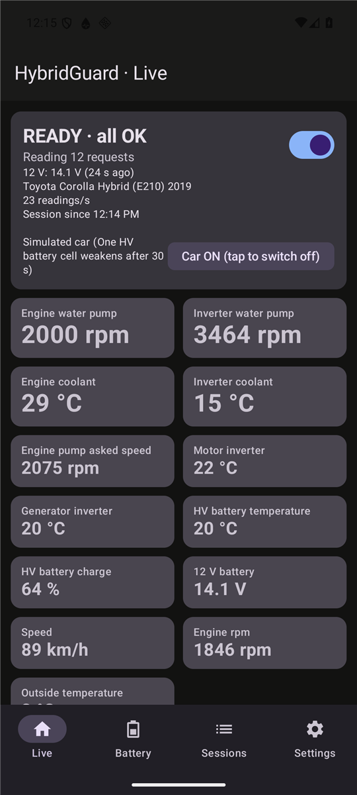
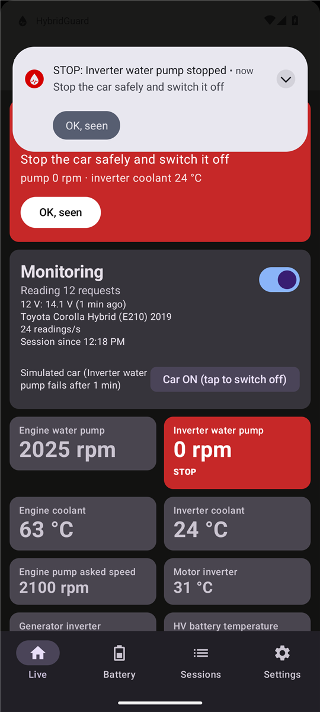
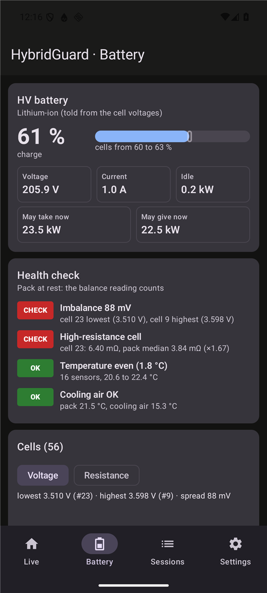
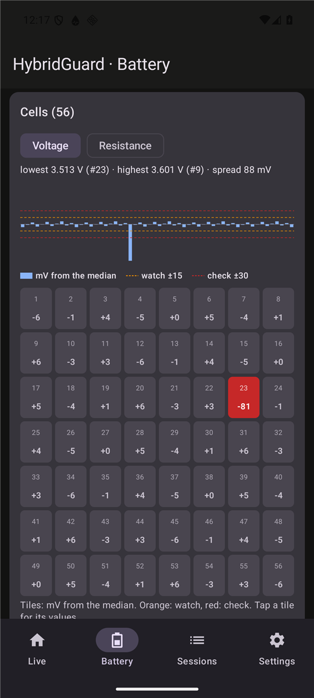
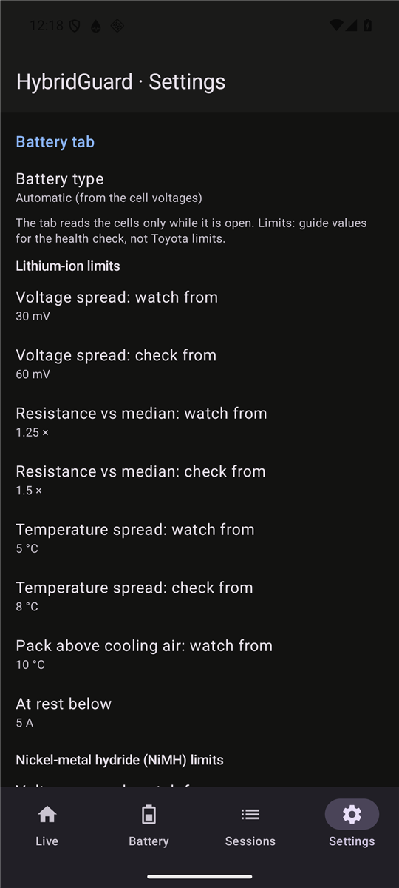

# HybridGuard

Android phone app (no Android Auto) that watches the cooling of a Toyota
hybrid through a Bluetooth **OBD-II adapter** left plugged into the OBD
port: the **engine water pump**, the **inverter water pump**, the engine and
inverter coolant, and more. It starts by itself when the car is READY,
shows the values in the notification shade, raises alarms on the phone, and
saves a log with charts for every session. A **Battery** tab shows the
hybrid battery: charge, power limits, every cell's voltage and resistance,
temperatures and a health check, for lithium-ion and NiMH packs.

| Live | Cooling alarm | Battery | Battery cells | Battery settings |
|---|---|---|---|---|
|  |  |  |  |  |

*Screenshots from the emulator with the simulated car (scenarios
"inverter water pump fails" and "one HV battery cell weakens"): no real
car data.*

It shares its read-only OBD core (`:core-obd`), vehicle profiles and alarm
engine (`:core-data`) with HybridCrown, the author's Android Auto
dashboard; the phone app (`:app`) is built for background monitoring.

> **Disclaimer.** HybridGuard is a hobby project, not affiliated with or
> endorsed by Toyota. It only reads from the car, but it is not a
> substitute for the car's own warning lights, for servicing, or for your
> attention while driving. The values and alarm limits come from community
> data and from one owner's car: they may be wrong for yours. Use it at
> your own risk (see [LICENSE](LICENSE)).

## Supported cars and adapters

- **Cars**: Toyota Corolla Hybrid E210 (2019–2026, tested on a 2019 UK
  1.8 hatchback). Any other car gets the generic OBD-II values (speed,
  coolant, ...) and no pump alarms until a profile is added (see
  [More car models](#more-car-models)).
- **Adapters**: an ELM327-compatible adapter over **Bluetooth Classic**
  (serial port profile); STN-based ones (STN11xx / STN2xxx) work best.
  BLE-only adapters are not supported yet. Because it stays plugged in, it
  must **sleep by itself** when the car is off (most good adapters do after
  10–30 min); one that never sleeps drains the 12 V battery. Details:
  `docs/03-adapter-protocol.md`.

## How it works

1. **Waiting.** An ongoing notification (its own channel, "Waiting for
   the car") says what the app waits for; it is only posted again when its
   text changes. To hide it: Settings → Notification while waiting → off.
   The app keeps watching, and the live values and alarms still show.
   Every 20 s (settable) it tries to reach the adapter over Bluetooth. Some
   time after the car is switched off the adapter sleeps, so nothing answers.
2. **Is the car READY?** When the adapter answers, the app asks it only
   for its supply voltage (`ATRV`): the adapter answers that itself,
   nothing is sent on the car's bus, so a parked car is never woken up.
   About 14 V means the car is READY (the DC-DC converter charges the
   12 V battery); about 12.4 V means parked. The limit (13.2 V) is a setting.
3. **Monitoring.** READY: the app reads the car (read-only services
   `01 09 21 22` only, enforced in `ReadOnlyPolicy`), picks the car model
   from the VIN, and watches the pumps and temperatures on every reading.
   When the VIN does not give the model year (most European VINs), the app
   asks for it once (a quiet notification, then a list in the app) and
   assumes the profile's first year until then.
   The notification shows the values you chose (default: engine pump,
   inverter pump, coolant, inverter coolant), updated every 2 s.
4. **Car off.** When the car stops answering for 30 s the session ends and
   is saved; the app goes back to waiting.

Ways to make waiting cheaper on the phone battery (Settings → Automatic
connection): look **only while the phone is connected to the car's
Bluetooth** (stereo / hands-free), and **look at once when the phone
starts charging**. When the car's Bluetooth connects, the app looks at
once (it does not wait for its timer), then every 5 s (setting) until the
car is READY: the stereo usually connects a few seconds before the hybrid
system is READY. Choosing the car's Bluetooth helps in "Always" mode too.

## Alarms

From the car profile's `alarms.json` (Corolla: engine pump stopped / slow,
inverter pump stopped / slow, engine coolant hot / very hot / rising fast,
inverter coolant hot / very hot / rising fast; optional and off by default:
HV battery hot, motor inverter hot, 12 V not charging). The Corolla gives
no oil temperature, so the engine is watched through its coolant.
Every check can be switched on or off, made a Caution or a STOP, and every
number changed (limit, how long it must last, ...); **Reset** goes back to
the profile's value.

- **STOP**: red heads-up notification, full screen over the lock screen,
  alarm tone on the alarm volume, vibration, and a spoken warning (like
  navigation: through the car speakers when the phone is connected to the
  car). Repeated every 30 s until **OK, seen**, then a reminder every 5 min
  while it lasts.
- **Caution**: amber notification, sound and voice once.
- **Monitoring interrupted**: the adapter stopped answering while the car
  was READY (30 s). **Not reading …**: a pump value stopped arriving while
  READY (60 s), so its alarms could not work.
- **Test the alarm** in Settings plays a STOP alarm.

While an alarm sounds the music **pauses** (it resumes after the warning),
the tone plays first and the warning is spoken after it, not over it. For
a STOP alarm the alarm volume is raised to 100 % and the media volume (the
voice, also through the car speakers) to at least 80 %, then put back.

All the sound, vibration, voice, volume and repeat options are settings.

## Battery tab

The hybrid (HV) battery, read **only while the tab is open**: its long
replies (56 cell voltages, 56 cell resistances on the Corolla) are never
polled in the background, so they never slow the cooling watch.

- **Pack**: charge (with the lowest / highest cell charge), voltage,
  current, power (giving / charging / idle), and how much power the
  battery may take and give now (the car's own charge / discharge limits).
- **Health check**: balance (highest minus lowest cell, judged only at
  rest, below 5 A), the cell with the highest internal resistance against
  the pack median, temperature spread between the pack's sensors, and the
  pack against its cooling air (a blocked battery fan or intake filter).
  Each line is OK / WATCH / CHECK.
- **Cells**: a chart of every cell's difference from the median with the
  limits dashed, and a tile per cell (tap one for its values); the same
  for resistance.
- **Temperatures and cooling**, and the **12 V battery** (voltage, current,
  temperature, capacity).

**Lithium-ion and NiMH.** The pack type comes from the car profile
(`battery.json`) or, when the profile covers cars with either pack, from
the cell voltages (about 3.6 V for a lithium-ion cell, about 1.2 V for a
NiMH cell, 14-16 V for a NiMH block); Settings → Battery tab → Battery type
sets it by hand. A NiMH pack that reports blocks instead of cells is
judged on its blocks. Each pack type has its own limits, all of them
settings; they are guide values, not Toyota limits.

## Sessions and charts

Every session is saved in the app's storage (`files/sessions/<date-time>/`):
`values.csv` (one row per second by default, every value you chose) and
`summary.json` (car model and year, distance, 12 V at start, min / average /
max of every value, every alarm with its start and end time, why it
ended). The **Sessions** tab lists them (OK / Caution / STOP badge); a
session shows the summary, the alarms, a min / avg / max table and a chart
per group (water pumps, coolant, inverter, …) with the alarm limits
as dashed lines; touch and slide over a chart to read the values. **Share
CSV** sends the values to mail, Drive, a spreadsheet. Sessions shorter than
60 s without alarms are not kept; old sessions are removed after 365 days
or beyond 500 (all settings). The **Live** tab shows the same charts for the
last 10 minutes.

## More car models

No car is known in Kotlin: a car model is a profile folder under
`core-data/src/main/resources/vehicles/<profile-id>/` (signals, ECU
addresses, role mapping, `alarms.json`, `battery.json`), listed in `vehicles/index.json`. The
right profile is chosen from the VIN (`profile.json` → `match.vinPrefixes`),
and each signal can be limited to model years (`dbgfilter`), so the
Corolla E210 profile already covers 2019–2026. To add a car (a Corolla
2020+ with a different VIN prefix, a C-HR, a Yaris Cross): add its VIN
prefix to an existing profile or add a new folder, confirm its PIDs on the
car first (Settings → Sessions and charts → keep the raw adapter
replies), and build. Settings → Car model also lets you pick the model and
year by hand, and change the model year the app asked for. Alarm settings
are kept per check id, so profiles that share ids share the owner's limits.

## Install on the phone

Build (below), copy `app/build/outputs/apk/debug/app-debug.apk` to the phone
and open it (allow installing from that source). Then:

1. Pair the OBD adapter in the phone's Bluetooth settings (once).
2. Open HybridGuard: allow **Nearby devices** and **Notifications**.
3. Settings → OBD adapter → your adapter.
4. Live tab → **Allow** "run in the background" (battery optimisation off),
   otherwise Android may stop the monitor in your pocket.
5. Optional: Settings → Alarm notification settings → let STOP alarms
   through Do Not Disturb.

## Try it on the PC (emulator)

The emulator has no Bluetooth, so use the **simulated car**: Settings →
OBD adapter → Simulated car, choose a scenario (normal drive, inverter
pump fails after 1 min, engine pump fails after 1 min, coolant overheats
after 2 min, one HV battery cell weakens after 30 s), then on the Live tab tap **Car OFF (tap to start)**. The app
finds the "READY" car, monitors it, raises the alarms, and saves a session
when you switch the simulated car off (it ends 30 s later, like a real car).

Any Android 8+ virtual device works (e.g. a Pixel image, x86_64). If the
emulator's own window crashes at start (seen with some AMD GPU drivers),
run it **headless** and look at it from Android Studio's Device Manager or
take screenshots with adb (replace `<avd-name>` with yours):

```powershell
& "$env:LOCALAPPDATA\Android\Sdk\emulator\emulator.exe" -avd <avd-name> -no-window -gpu swiftshader
```

```powershell
& "$env:LOCALAPPDATA\Android\Sdk\platform-tools\adb.exe" install -r -g app\build\outputs\apk\debug\app-debug.apk
```

## Build

Needs a JDK 17 or newer; Android Studio's bundled one works:

```bash
export JAVA_HOME="/c/Program Files/Android/Android Studio/jbr"   # Git Bash on Windows
./gradlew test            # unit tests (core modules)
./gradlew assembleDebug   # app/build/outputs/apk/debug/app-debug.apk
```

Modules: `:core-obd` (pure Kotlin: ELM327 driver, read-only allow-list,
`ATRV` quick check), `:core-data` (pure Kotlin: profiles, decoding, alarm
engine, owner's alarm tuning, simulator), `:app` (monitor, service,
notifications, sessions, charts, battery tab, settings).

## Docs

`docs/02-vehicle-data.md` (what each value is and how sure it is),
`docs/03-adapter-protocol.md` (adapters and the ELM327 protocol),
`docs/07-extensibility.md` (profiles and roles), carried over from
HybridCrown. Code comments that cite `docs/05`, `docs/06` or `docs/08`
refer to HybridCrown's planning documents, which are not part of this
repository.

## Contributing

Issues and pull requests are welcome, above all **logs and VIN prefixes
from other Toyota hybrids** (C-HR, Yaris Cross, Corolla 2.0, Touring
Sports, ...). Before sharing a log or a screenshot, hide the VIN's last six
characters. The app must stay **read-only** on the car: only OBD services
`01`, `09`, `21` and `22` are allowed (`ReadOnlyPolicy` and its test);
changes that write to the car, clear codes or run tests on it will not be
accepted.

## License

The code is under the [MIT License](LICENSE). The vehicle signal
definitions in `core-data/src/main/resources/vehicles/` come from the
[OBDb](https://github.com/OBDb) project and are under
[CC BY-SA 4.0](core-data/src/main/resources/vehicles/LICENSE-CC-BY-SA-4.0.txt):
see [ATTRIBUTION.md](core-data/src/main/resources/vehicles/ATTRIBUTION.md).
